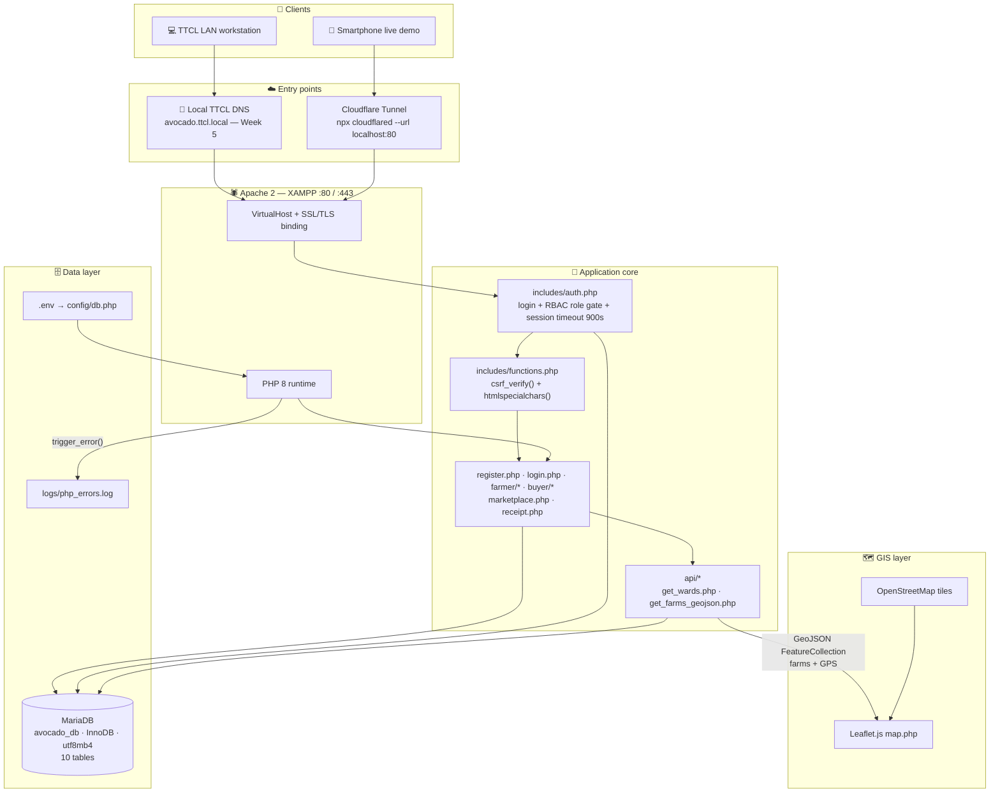
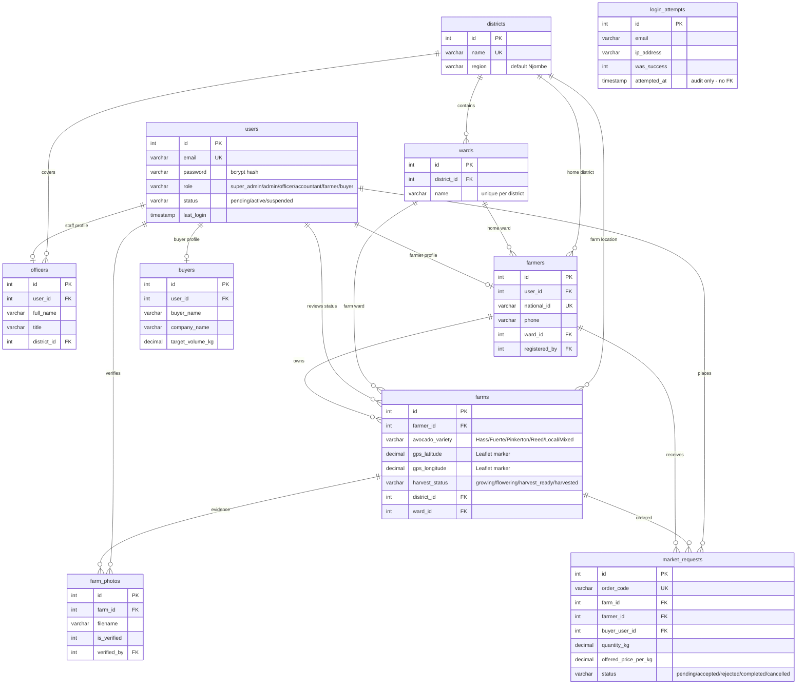
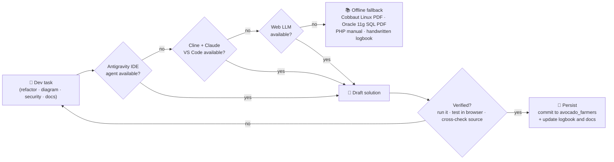

<div align="center">

# 🥑 FIELD REPORTS — TTCL & UAUT

> ### **From orientation to production in six weeks.**


📦 **Live project repo:** [mwijay12/avocado-farmers-](https://github.com/mwijay12/avocado-farmers-) · 🎨 **Diagram style sibling:** [mwijay12/hype-alarm](https://github.com/mwijay12/hype-alarm)

---

## 📑 Table of Contents

| # | Section | # | Section |
|---|---------|---|---------|
| 1 | [🚀 Project Identity](#-section-1-project-identity) | 5 | [📅 Week-by-Week Diagram Pages](#-section-5-week-by-week-diagram-pages) |
| 2 | [🏗️ System Architecture](#%EF%B8%8F-section-2-system-architecture) | 6 | [📁 Repo Map](#-section-6-repo-map) |
| 3 | [🗄️ Database Relationships](#%EF%B8%8F-section-3-database-relationships) | 7 | [🔍 Viewing the Diagrams](#-section-7-viewing-the-diagrams) |
| 4 | [🤖 AI Dev Fallback Chain](#-section-4-ai-assisted-development-fallback-chain) | 8 | [📎 Companion Documents](#-section-8-companion-documents) |

</div>

---

# 🚀 SECTION 1: PROJECT IDENTITY

<div align="center">

> *"Six weeks, one system: register avocado farmers, map their orchards, and sell their harvest — logged day by day, with diagrams for every week."*

</div>

### 👶 For a 10-year-old
A student spent 6 weeks at TTCL (the telephone company) learning how computers, networks and servers work. As his big task he built an online shop for avocado farmers in Njombe: farmers sign up with their farm's location on a map, buyers find the farms and order avocados, and the system makes sure two buyers can't buy the same harvest at the same time. Every week of the journey has a page here with 3 hand-drawn "maps of the machine": how it's built, how its memory is organized, and how AI helped build it.

### 👨‍💻 For a developer
**Field Reports** is the documentation home of the **Practical Training Logbook** (TTCL host · UAUT College of ICT · BSc ICT). The field system is the **Avocado Farmers Registration & Digital Marketplace System** — a zero-dependency LAMP app (pure PHP 8 + MariaDB InnoDB + Leaflet.js/OSM + Chart.js) in `C:\xampp\htdocs\avocado_farmers`. Six calendar weeks (24 Aug → 2 Oct 2026) are logged; **each week has its own page with 3 native-GitHub-Mermaid diagrams**: a **system architecture** flowchart, a **database relationship** ERD slice, and an **AI-assisted development fallback chain** — the same README style as [hype-alarm](https://github.com/mwijay12/hype-alarm).

---

# 🏗️ SECTION 2: SYSTEM ARCHITECTURE

> The full production topology after Week 6: dual entry (TTCL LAN DNS + Cloudflare tunnel demo), hardened request pipeline, InnoDB data layer, Leaflet GIS layer, centralized error logging.



**Request lifecycle in one line:** client → TLS/vhost → `auth.php` (role + 900s session) → `functions.php` (CSRF/XSS) → business page → `mysqli_prepare` → InnoDB → response (HTML / GeoJSON) → Leaflet render.

---

# 🗄️ SECTION 3: DATABASE RELATIONSHIPS

> **Engine:** MariaDB / MySQL · InnoDB · utf8mb4 · FKs with `CASCADE` / `RESTRICT` / `SET NULL` · Source of truth: `avocado_farmers/database/schema.sql` (10 tables).



**Key indexes:** `idx_users_role`, `idx_users_status`, `idx_farmers_name`, `idx_farms_status`, `idx_farms_variety`, `idx_photos_farm`, `idx_orders_farm`, `idx_orders_farmer`, `idx_orders_status` (added Week 3), plus `idx_email_time` / `idx_ip_time` on `login_attempts` (brute-force lookups).

---

# 🤖 SECTION 4: AI-ASSISTED DEVELOPMENT FALLBACK CHAIN

> The system itself is deliberately **zero-AI** (no API keys in the app). The AI lives in the *development workflow* — same escalation philosophy as the alarm app's provider chain: try the smartest tier first, degrade gracefully, **never block the work**.



- **Tier 1 — Antigravity IDE agent:** scaffolding, multi-file refactors, generated docs.
- **Tier 2 — Cline + Claude in VS Code:** deep code review (CSRF/XSS/transaction audits), diagram authoring (this very repo).
- **Tier 3 — Web LLM:** quick technical guidance and translations.
- **Offline fallback:** local PDFs (Cobbaut *Linux Fundamentals*, McGraw-Hill *Oracle 11g SQL*), phpMyAdmin `EXPLAIN`, handwritten log — the task still ships.
- **Rule:** AI output is never committed unverified — every draft must pass the *run it / test it* gate (the same "empty response = failure" spirit as the hypealarm provider chain).

---

# 📅 SECTION 5: WEEK-BY-WEEK DIAGRAM PAGES

> One page per week, each carrying its own 3 diagrams (architecture · ERD slice · AI chain), filled through the Friday of the week containing 30 Sept 2026.

| Week | Dates (2026) | Theme | Diagram page |
|---|---|---|---|
| **1** | Mon 24/08 → Fri 28/08 | Orientation · Network layout · PC hardware · PHP kickoff | [WEEK-01.md](weeks/WEEK-01.md) |
| **2** | Mon 31/08 → Fri 04/09 | Maintenance · Presentation 1 · Backend refactor · Inventory | [WEEK-02.md](weeks/WEEK-02.md) |
| **3** | Mon 07/09 → Fri 11/09 | Linux CLI · RBAC · DB indexing · GIS Leaflet | [WEEK-03.md](weeks/WEEK-03.md) |
| **4** | Mon 14/09 → Fri 18/09 | Python backup automation · Async APIs · CSRF/XSS · Market concurrency · Sprint 2 | [WEEK-04.md](weeks/WEEK-04.md) |
| **5** | Mon 21/09 → Fri 25/09 | Sprint review · Virtual hosts · SSL/TLS · DNS routing · DB stress test | [WEEK-05.md](weeks/WEEK-05.md) |
| **6** | Mon 28/09 → Fri 02/10 | UAT · CSV→MySQL migration · User manual · Defense prep | [WEEK-06.md](weeks/WEEK-06.md) |

---

# 📁 SECTION 6: REPO MAP

```text
Field Reports/
├── README.md                                  ← you are here (3 global diagrams)
├── weeks/
│   ├── WEEK-01.md … WEEK-06.md                ← 6 weekly pages × 3 diagrams each
├── FIELD_PRACTICAL_TRAINING_LOGBOOK_GUIDE.md  ← full Swahili/English logbook guide
├── PRACTICAL_TRAINING_LOGBOOK_MASTER.docx     ← printable master logbook
├── PRACTICAL_TRAINING_LOGBOOK_MASTER.pdf      ← PDF version
└── build_full_field_documents.py              ← docx generator (python-docx)
```

---

# 🔍 SECTION 7: VIEWING THE DIAGRAMS

- **GitHub** — every diagram is a fenced Mermaid code block (mermaid language tag), so all 3 diagram families (architecture, DB relationships, AI fallback chain) render **natively** in blob views, README previews, PR diffs and Issues. No images, no build step, no external service.
- **VS Code** — install the *Markdown Preview Mermaid Support* extension to get identical rendering in the preview pane.
- **Logbook printing** — diagrams are code, so they survive copy-paste; the `.docx`/`.pdf` masters carry the printed versions.

---

# 📎 SECTION 8: COMPANION DOCUMENTS

| Document | What it is |
|---|---|
| [FIELD_PRACTICAL_TRAINING_LOGBOOK_GUIDE.md](FIELD_PRACTICAL_TRAINING_LOGBOOK_GUIDE.md) | Full Swahili/English guide: Weeks 1–4 day logs, Day 9–10 deep dive, Weeks 5–6 preview |
| [PRACTICAL_TRAINING_LOGBOOK_MASTER.docx](PRACTICAL_TRAINING_LOGBOOK_MASTER.docx) | University-format master logbook (metadata cards, weekly tables, photo galleries) |
| [PRACTICAL_TRAINING_LOGBOOK_MASTER.pdf](PRACTICAL_TRAINING_LOGBOOK_MASTER.pdf) | Same, print-ready |
| [build_full_field_documents.py](build_full_field_documents.py) | Generator script — edit weekly data in one place, rebuild the docx |
| [avocado-farmers-](https://github.com/mwijay12/avocado-farmers-) | The field system itself (pure PHP 8 + MariaDB + Leaflet) |
| [hype-alarm](https://github.com/mwijay12/hype-alarm) | Style reference for these diagram pages |

---

<div align="center">

*Prepared as part of BSc ICT Practical Training — TTCL × UAUT — 24 Aug → 2 Oct 2026.*

**All 3 diagram families — architecture, DB relationships, AI fallback chain — render natively on GitHub.** ✅

</div>


