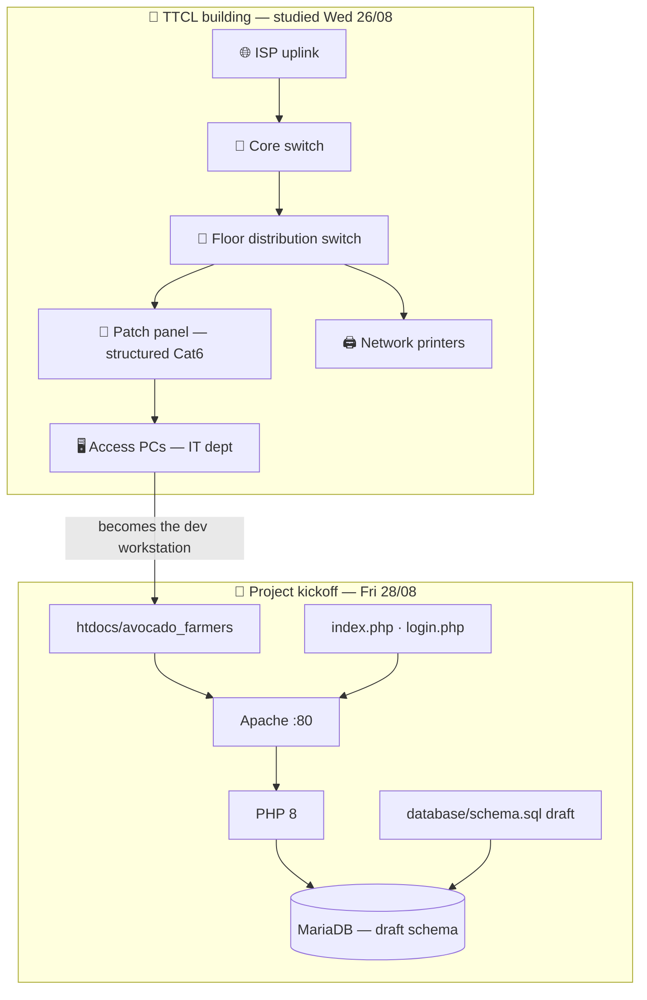
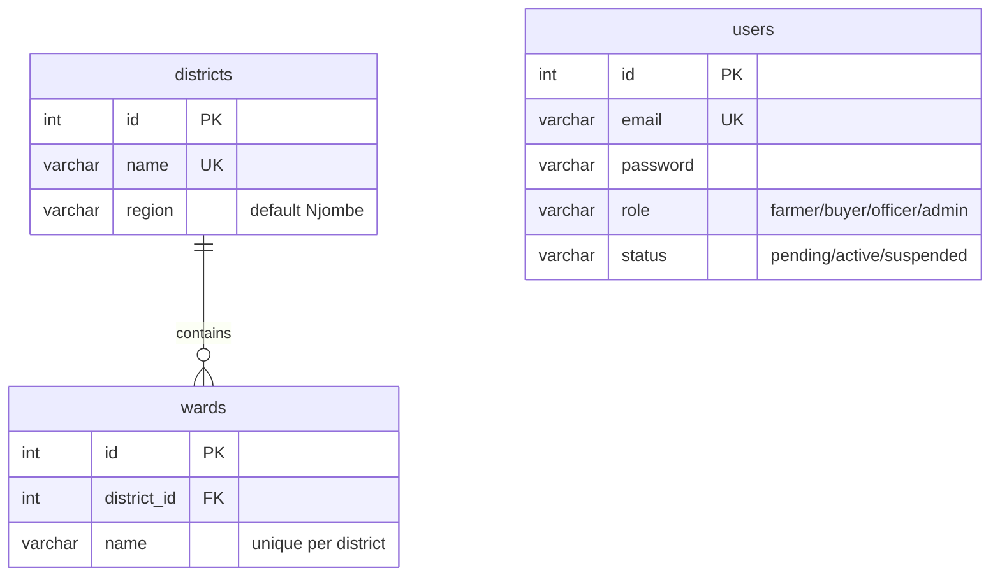
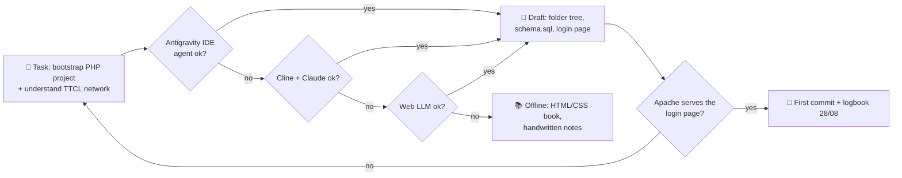

# 📅 WEEK 1 — Orientation, Network Layout & PHP Project Kickoff

**TTCL × UAUT Practical Training · David Erick Mwijage (Reg 250/13055)**

[← README index](../README.md) · [Week 2 →](WEEK-02.md)

> **Theme:** learn how TTCL's building is wired, fix its computers, then start the real project — the Avocado Farmers System in native PHP on XAMPP.

## 🗓️ Day-by-day

| Day | Date | Activity | Output |
|---|---|---|---|
| Mon | 24/08 | Orientation & distribution of duties — TTCL corporate structure, IT dept procedures | Duty allocation, IT/network dept |
| Tue | 25/08 | Public holiday | — |
| Wed | 26/08 | Enterprise network layout & cabling — core/distribution switches, patch panels, access layer | Floor-to-core cabling map |
| Thu | 27/08 | Computer hardware & peripherals maintenance — RAM, PSU, printers, slow-boot diagnostics | Serviced office PCs |
| Fri | 28/08 | **Project kickoff:** Avocado Farmers Registration & Digital Marketplace (HTML/CSS/JS + native PHP, XAMPP) | `htdocs/avocado_farmers` bootstrap + draft schema |

## 🏗️ Diagram 1 — Architecture (what this week built)

**Soma haraka (quick read):** the building wiring traced on Wednesday becomes Friday's dev target — one access PC now serves Apache + MariaDB straight from `htdocs`.

## 🗄️ Diagram 2 — Database relationships (Week 1 schema draft)

> Week 1 ships a 3-table draft (`districts → wards`, plus `users` for the login gate). `farmers`, `farms`, `farm_photos` and `market_requests` land in Weeks 2–4 — see the [global ERD](../README.md#%EF%B8%8F-section-3-database-relationships).

## 🤖 Diagram 3 — AI-assisted fallback chain (this week)

**Fallback rule of the week:** if the agent stack is unavailable, the scaffold is drawn on paper first and typed by hand — work never stops.

## 🧰 Machinery & tools

| Area | Tools |
|---|---|
| Network | Core/distribution switches, patch panels, RJ45 Cat6, cable tester |
| Hardware | Screwdrivers, compressed air, RAM testers, PSU checker, printer kits |
| Dev | XAMPP (Apache + MariaDB), VS Code, phpMyAdmin |

## 📝 Ufafanuzi wa Kiufundi

- *Structured cabling* imeelezwa top-down: patch panel → distribution switch → core switch.
- Draft schema iko 3NF kuanzia siku ya kwanza — `wards` haina duplicate names ndani ya district moja (`UNIQUE (district_id, name)`).
- XAMPP ilichaguliwa kwa *zero-dependency hosting* — hakuna `composer install` wala Node server inayohitajika kwenye seva za TTCL.

---

[← README index](../README.md) · [Week 2 →](WEEK-02.md)

