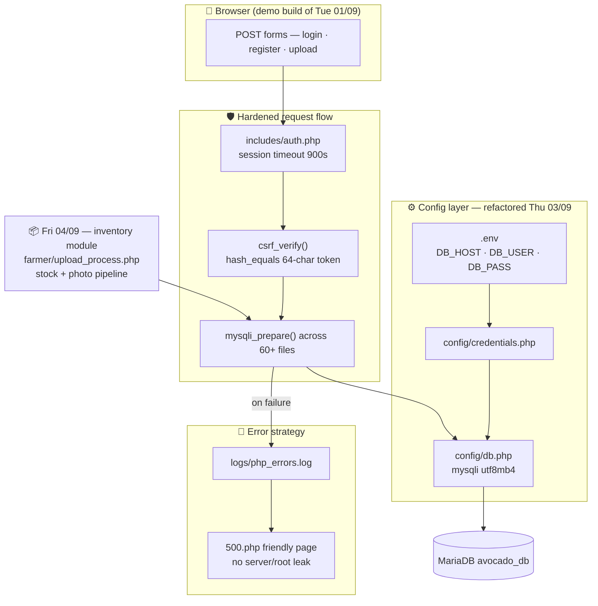
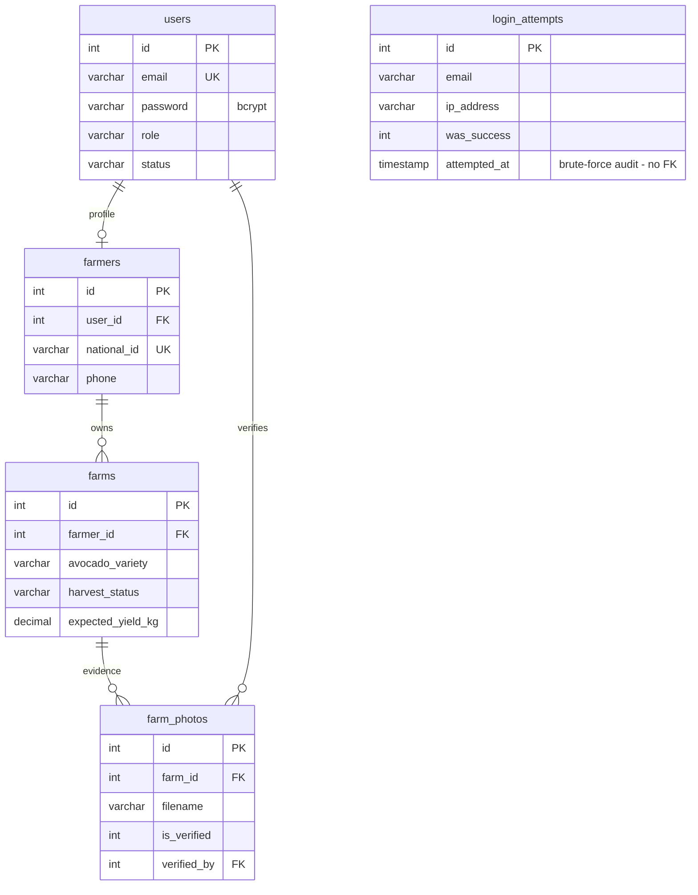
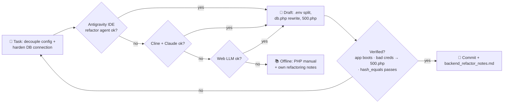

# 📅 WEEK 2 — Maintenance, Presentation 1, Backend Refactor & Inventory

**TTCL × UAUT Practical Training · David Erick Mwijage (Reg 250/13055)**

[← README index](../README.md) · [Week 1 ←](WEEK-01.md) · [Week 3 →](WEEK-03.md)

> **Theme:** clean the machines, show the prototype to the panel, then make the backend worthy of it — config decoupling, prepared statements, custom error pages, and the stock/photo-verification module.

## 🗓️ Day-by-day

| Day | Date | Activity | Output |
|---|---|---|---|
| Mon | 31/08 | Computer maintenance & disk optimization — de-dusting, OS updates, disk cleanup, slow-boot fix | Faster booting office PCs |
| Tue | 01/09 | Frontend study & system design polish (brand palette, layout) | UI cleanup for demo |
| Wed | 02/09 | **Presentation 1** to panel — farmer registration, farm maps, marketplace, photo verification on localhost | Review + suggestions |
| Thu | 03/09 | **Backend refactoring & DB standardization** — `.env` → `config/credentials.php` → `config/db.php`, `mysqli_prepare`, custom `500.php` | Secure, leak-free backend |
| Fri | 04/09 | Product inventory/stock module + photo verification pipeline (`farmer/upload_process.php`, `farm_photos`) | Stock + evidence module |

## 🏗️ Diagram 1 — Architecture (what this week built)

**Soma haraka:** credentials left the source code (`.env`), every query became a prepared statement, and a failed query now logs quietly and shows a friendly page instead of leaking `root` + server name.

## 🗄️ Diagram 2 — Database relationships (inventory & photo evidence)

- `login_attempts` ni **audit table** bila FK — 5 failed logins / 15 min zinafunga IP/email (brute-force lockout, Week 2 security sweep).
- `farm_photos.verified_by → users.id` (`SET NULL`): afisa anayethibitisha picha akiondolewa, picha haipotei.

## 🤖 Diagram 3 — AI-assisted fallback chain (this week)

**Fallback rule of the week:** AI inapewa diff kabla ya commit; ikiwa manual tests hazipati, refactor inarudishwa (`git checkout`) — hakuna half-baked config kwenye `htdocs`.

## 🧰 Machinery & tools

| Area | Tools |
|---|---|
| Maintenance | Compressed air, isopropyl alcohol, disk cleanup utilities, OS updates |
| Backend | PHP 8, MariaDB, `.env`, phpMyAdmin, VS Code |
| Security | bcrypt (`password_hash`), CSRF token generator, error log review |
| Demo | Apache localhost, projector for Presentation 1 |

## 📝 Ufafanuzi wa Kiufundi

- Credentials **hazipo tena** kwenye source — `.env` inasomwa na `config/db.php` pekee; `500.php` inazuia *information disclosure* ya server name + root password.
- `mysqli_prepare` ilisambazwa kwenye files zote 60+ — SQLi door imefungwa kabisa.
- Stock module inatumia `farm_photos` kama *evidence chain*: picha isiyothibitishwa haionekani kwa buyers.

---

[← README index](../README.md) · [Week 1 ←](WEEK-01.md) · [Week 3 →](WEEK-03.md)

