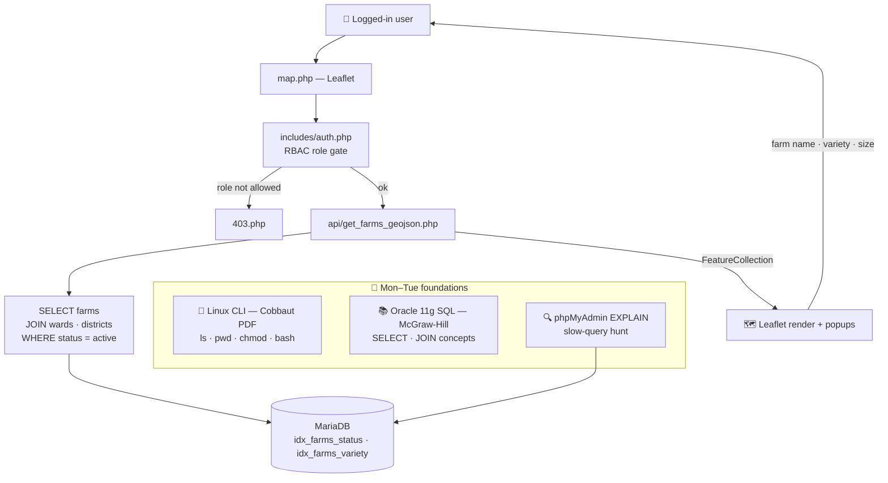
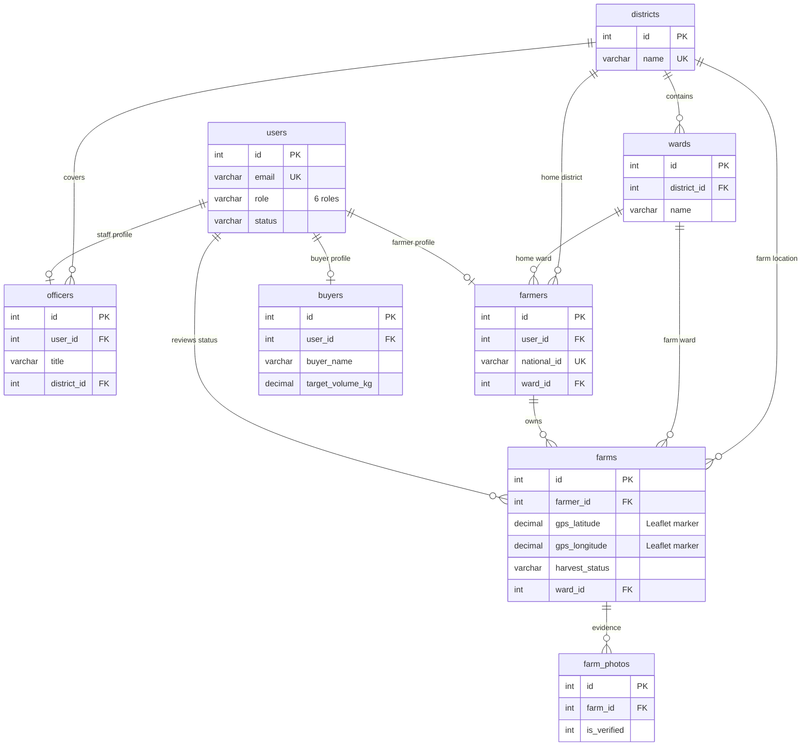
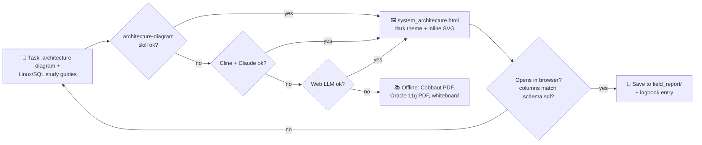

# 📅 WEEK 3 — Linux CLI, RBAC, DB Indexing & GIS Mapping

**TTCL × UAUT Practical Training · David Erick Mwijage (Reg 250/13055)**

[← README index](../README.md) · [Week 2 ←](WEEK-02.md) · [Week 4 →](WEEK-04.md)

> **Theme:** broaden the foundations (Linux CLI, Oracle SQL reading), then harden roles and indexes — and make the farm map come alive with Leaflet + OpenStreetMap.

## 🗓️ Day-by-day

| Day | Date | Activity | Output |
|---|---|---|---|
| Mon | 07/09 | Linux fundamentals — Cobbaut PDF (169 pp); `ls`, `pwd`, `chmod`, `bash` practice | `linux_notes.md` |
| Tue | 08/09 | Oracle/SQL fundamentals — McGraw-Hill 11g SQL (690 pp) + connect to `avocado_db`, verify table counts | `oracle_notes.md` |
| Wed | 09/09 | System design diagram + architecture doc (`system_architecture.html`, dark theme, inline SVG) | Visual architecture page |
| Thu | 10/09 | **RBAC hardening** (6 roles gate) + **DB indexing** (`idx_orders_status`, `idx_farms_status`, …) + `EXPLAIN` checks | Role-gated pages, faster queries |
| Fri | 11/09 | **GIS:** `api/get_farms_geojson.php` + Leaflet `map.php` with OpenStreetMap tiles & farm popups | Interactive farm map |

## 🏗️ Diagram 1 — Architecture (what this week built)

**Soma haraka:** RBAC decides *who* sees the map, the new indexes decide *how fast* the GeoJSON query answers, and Leaflet decides *how nice* it looks.

## 🗄️ Diagram 2 — Database relationships (geo hierarchy + role profiles)

- **RBAC** inasomea `users.role` (6 values) moja kwa moja — hakuna role table nyingine; `officers/farmers/buyers` ni profile extensions za `users`, zote zina `user_id UNIQUE`.
- **GIS join path:** `farms.gps_latitude/gps_longitude → GeoJSON feature → Leaflet marker`, na `farms.ward_id → wards → districts` hutaja eneo kamili kwenye popup.

## 🤖 Diagram 3 — AI-assisted fallback chain (this week)

**Fallback rule of the week:** kila diagram/notes zinavalidheshwa dhidi ya `schema.sql` halisi — hakuna table au column iliyobuniwa ambayo haipo kwenye database.

## 🧰 Machinery & tools

| Area | Tools |
|---|---|
| Linux | Cobbaut *Linux Fundamentals* PDF, terminal practice |
| SQL | McGraw-Hill *Oracle 11g SQL* PDF, phpMyAdmin, `EXPLAIN` |
| RBAC | `includes/auth.php` role gate, `403.php` |
| GIS | Leaflet.js, OpenStreetMap tiles, `api/get_farms_geojson.php` |

## 📝 Ufafanuzi wa Kiufundi

- Indexi 9 mpya (`idx_orders_status`, `idx_farms_status`, `idx_farms_variety`, …) zilipimwa kwa `EXPLAIN` — GeoJSON queries hazisomi rows zote tena.
- `ON DELETE RESTRICT` kwenye `wards/districts` inazuia kufuta district yenye farms — data integrity ya kijiografia.
- Linux na Oracle ni *foundation reading* tu — hakuna claim ya mastery (honest, light tasks kama vilivyoagizwa).

---

[← README index](../README.md) · [Week 2 ←](WEEK-02.md) · [Week 4 →](WEEK-04.md)

