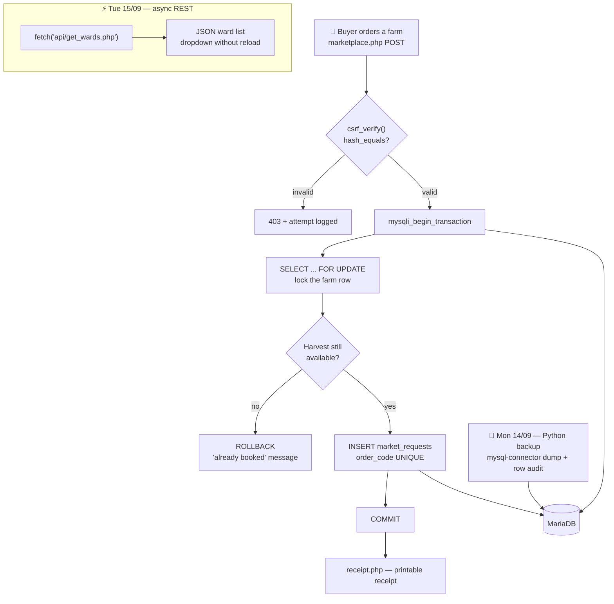
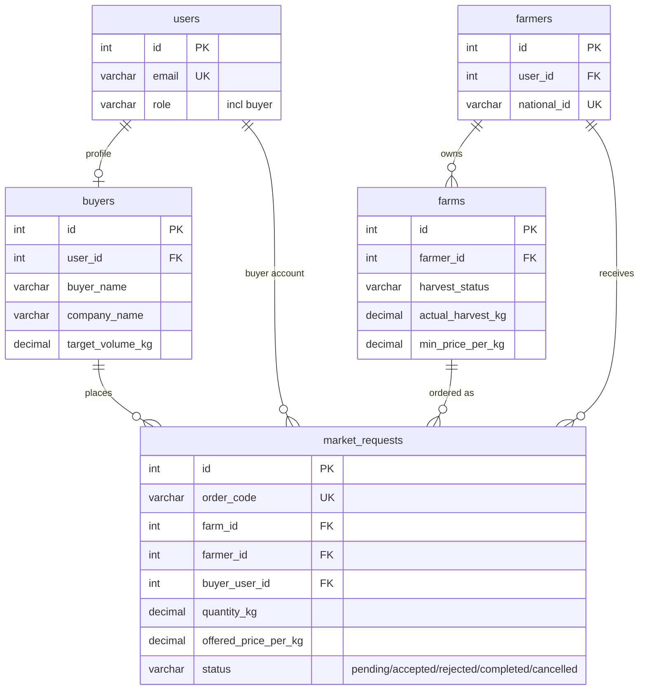
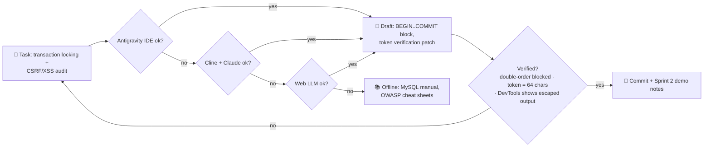

# 📅 WEEK 4 — Python Automation, Async APIs, Security Hardening & Market Concurrency

**TTCL × UAUT Practical Training · David Erick Mwijage (Reg 250/13055)**

[← README index](../README.md) · [Week 3 ←](WEEK-03.md) · [Week 5 →](WEEK-05.md)

> **Theme:** automate the boring parts (Python backups), make the UI snappier (async REST), lock the doors (CSRF/XSS/bcrypt), and stop double-selling harvests (transaction locking) — closed with a Sprint 2 demo over a live tunnel.

## 🗓️ Day-by-day

| Day | Date | Activity | Output |
|---|---|---|---|
| Mon | 14/09 | Python scripting for automated DB backup & audit (`mysql-connector`, scheduled dumps, row-integrity checks) | Backup + health-summary scripts |
| Tue | 15/09 | RESTful JSON endpoints + async Fetch (`api/get_wards.php`) — dynamic ward loading without reload | Snappier registration UX |
| Wed | 16/09 | CSRF/XSS hardening — `hash_equals` tokens on all POSTs, `htmlspecialchars` output escaping, bcrypt passwords | Audit-proof forms |
| Thu | 17/09 | Marketplace order dispatch + **concurrency transaction locking** (`BEGIN…COMMIT`), receipt module | Double-booking impossible |
| Fri | 18/09 | Dev environment setup (Node v24, Git 2.54, Python 3.11), E2E integration testing, Cloudflare tunnel demo, **Sprint 2 review** | Live link + supervisor sign-off |

## 🏗️ Diagram 1 — Architecture (what this week built)

**Soma haraka:** two buyers clicking "order" at the same millisecond both enter `BEGIN`, but `SELECT … FOR UPDATE` hands the farm row to one of them; the loser rolls back with a polite message instead of corrupting stock.

## 🗄️ Diagram 2 — Database relationships (marketplace core)

- `market_requests` ina **snapshot columns** (`farm_name_snapshot`, `buyer_name`) — oda inabaki na history hata kama farm/buyer watafutwa (`FK … SET NULL`).
- `order_code UNIQUE` + `BEGIN…COMMIT` transaction = hakuna double-booking wala duplicate order codes hata kwa race condition.

## 🤖 Diagram 3 — AI-assisted fallback chain (this week)

**Fallback rule of the week:** AI-written transaction code lazuliwa na *concurrency test ya mkono* — tabs mbili za browser, order moja, buyer mmoja lazima apate "already booked".

## 🧰 Machinery & tools

| Area | Tools |
|---|---|
| Automation | Python 3.11, `mysql-connector`, scheduled dumps |
| API | `api/get_wards.php`, Fetch API, Postman, Chrome DevTools |
| Security | `hash_equals`, `htmlspecialchars`, bcrypt |
| Concurrency | InnoDB transactions, `SELECT … FOR UPDATE` |
| Demo | Cloudflare tunnel (`npx cloudflared`), Node v24, Git 2.54 |

## 📝 Ufafanuzi wa Kiufundi

- `mysqli_begin_transaction` + `SELECT … FOR UPDATE` ni ngao dhidi ya *race condition* — buyer wawili hawawezi kunua yield moja.
- CSRF token ni 64-char, inathibitishwa na `hash_equals` (timing-safe); output zote zimeescape na `htmlspecialchars` — XSS imefungwa.
- Python backup script inaandika health summary (row counts per table) kwa archive ya TTCL IT.

---

[← README index](../README.md) · [Week 3 ←](WEEK-03.md) · [Week 5 →](WEEK-05.md)

