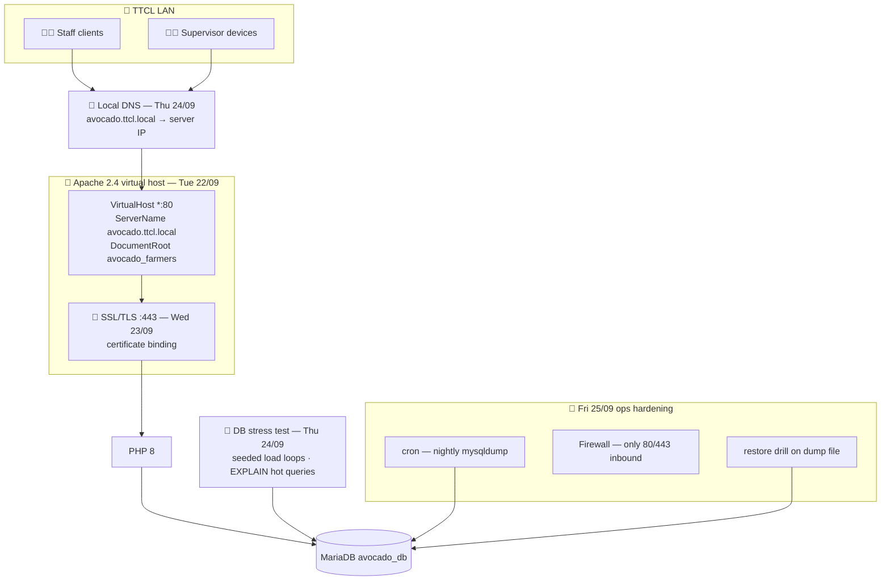
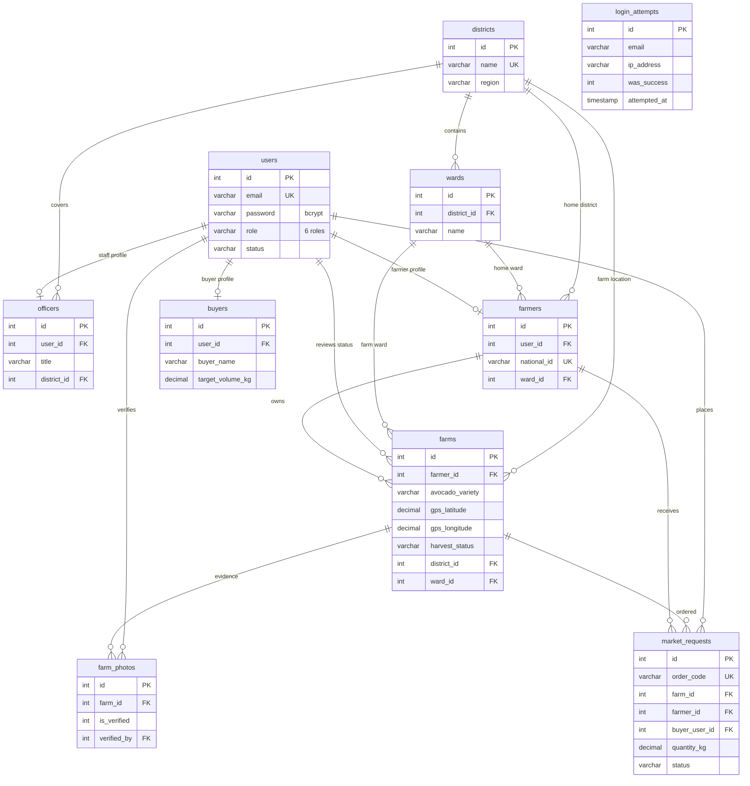
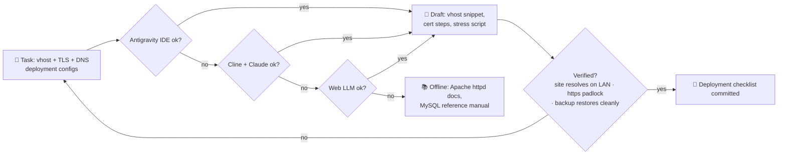

# 📅 WEEK 5 — Sprint Review & Enterprise Web Server Deployment

**TTCL × UAUT Practical Training · David Erick Mwijage (Reg 250/13055)**

[← README index](../README.md) · [Week 4 ←](WEEK-04.md) · [Week 6 →](WEEK-06.md)

> **Theme:** the supervisor's 21/09 review asked for "more time & architectures" — the answer is a proper enterprise deployment: virtual hosts, TLS, local DNS routing and database stress testing. *(Planned per the Weeks 5–6 preview in the logbook guide; verify against your handwritten log.)*

## 🗓️ Day-by-day

| Day | Date | Activity | Output |
|---|---|---|---|
| Mon | 21/09 | **Avocado system presentation & first review** — HTML/CSS/PHP walkthrough; feedback: extend architecture work | Review notes → Week 5 plan |
| Tue | 22/09 | Apache **Virtual Hosts** configuration — `ServerName avocado.ttcl.local`, dedicated `DocumentRoot` | Clean vhost instead of `/avocado_farmers` path |
| Wed | 23/09 | **SSL/TLS binding** — certificate on `:443` (internal CA / Let's Encrypt via tunnel domain) | `https://` padlock on LAN |
| Thu | 24/09 | **Local TTCL DNS routing** + **database stress testing** (seeded load loops, `EXPLAIN` on hot queries) | DNS name resolves; DB holds under load |
| Fri | 25/09 | Production hardening — firewall (only 80/443 in), cron nightly `mysqldump`, restore drill | Deployment checklist |

## 🏗️ Diagram 1 — Architecture (what this week built)

**Soma haraka:** the system stops being "a folder on XAMPP" and becomes *a named, encrypted, monitored service on the TTCL network* — with a backup that has actually been tested by restoring it.

## 🗄️ Diagram 2 — Database relationships (full schema, deployment view)

> Stress test ya Thu 24/09 inapima hasa *hot reads* juu ya `farms` (map) na `market_requests` (orders) — indexi zote 9 zimepitishwa kwenye `EXPLAIN` chini ya load.

## 🤖 Diagram 3 — AI-assisted fallback chain (this week)

**Fallback rule of the week:** config za server hazijaumizwa live — kila mabadiliko ya `httpd-vhosts.conf` yanapitiwa kwa `apachectl configtest` kabla ya restart.

## 🧰 Machinery & tools

| Area | Tools |
|---|---|
| Server | Apache 2.4 virtual hosts, XAMPP control panel |
| TLS | Certificate binding on `:443` (internal CA / tunnel domain) |
| Network | Local DNS entry, firewall rules (80/443 only) |
| DB ops | `seed_demo_data.php`, stress loops, `mysqldump` + restore drill |

## 📝 Ufafanuzi wa Kiufundi

- VirtualHost inatenganisha `avocado.ttcl.local` kutoka root ya Apache — URL Safi bila `/avocado_farmers` suffix.
- TLS inafungwa kwa certificate halali kwenye tunnel domain / internal CA kwa LAN — `https://` ina padlock bila warnings za mixed content.
- Restore drill ndiyo *ushahidi halisi* wa backup: dump imefunguliwa kwenye DB mpya na counts zimelinganishwa.

---

[← README index](../README.md) · [Week 4 ←](WEEK-04.md) · [Week 6 →](WEEK-06.md)

