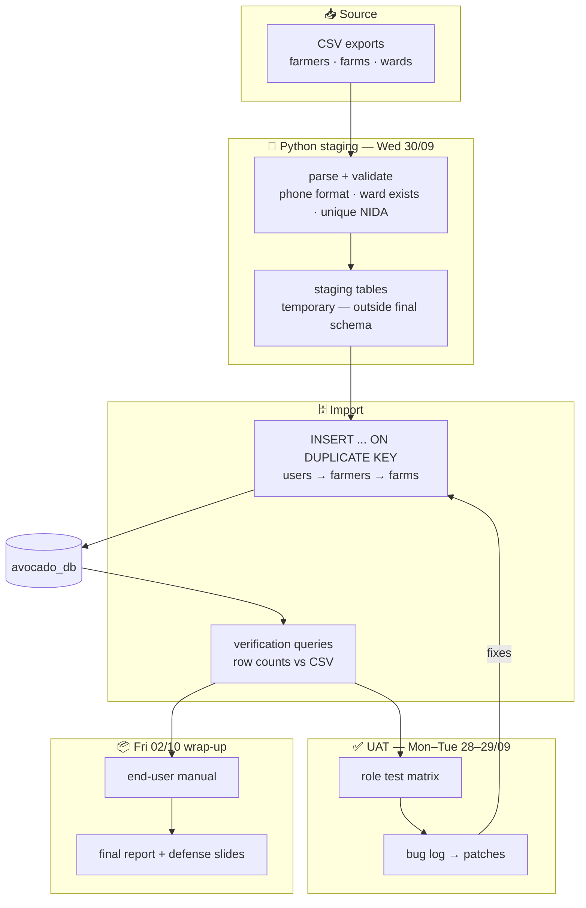
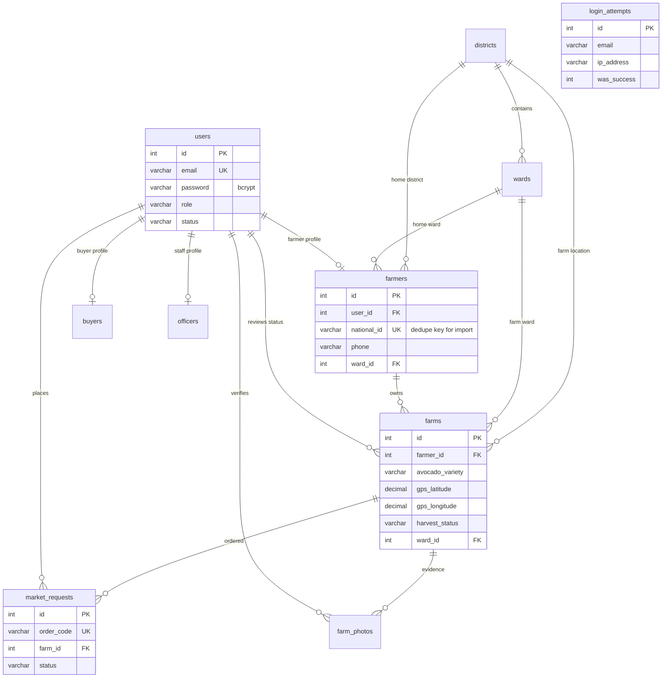
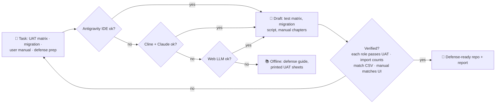

# 📅 WEEK 6 — UAT, Data Migration, User Manual & Defense Prep

**TTCL × UAUT Practical Training · David Erick Mwijage (Reg 250/13055)**

[← README index](../README.md) · [Week 5 ←](WEEK-05.md)

> **Theme:** hand the system to real users and real data — UAT by role, CSV→MySQL migration with validation, an end-user manual, and the final report + defense pack. *(Planned per the Weeks 5–6 preview; today, Wed 30/09, is migration day.)*

## 🗓️ Day-by-day

| Day | Date | Activity | Output |
|---|---|---|---|
| Mon | 28/09 | UAT planning — role-based test matrix (farmer · buyer · officer · admin · accountant) | Test scripts + acceptance criteria |
| Tue | 29/09 | UAT execution — real flows per role, bug log, hot-fixes | Signed test matrix |
| Wed | 30/09 | **Data migration: CSV → MySQL** — parse, validate (phone format, ward exists, unique NIDA), staged import, count verification | Real Njombe data inside `avocado_db` |
| Thu | 01/10 | End-user manual & documentation (screenshots per role, FAQ) | Printable user manual |
| Fri | 02/10 | Final Field Training report compilation & **defense preparation** | Defense-ready repo + report |

## 🏗️ Diagram 1 — Architecture (what this week built)

**Soma haraka:** data enters through a staging area and is only promoted after validation; every UAT bug loops back into the import/fix cycle until the counts match the CSVs exactly.

## 🗄️ Diagram 2 — Database relationships (final schema, migration view)

> **CSV staging** (Wed 30/09) ni *ephemeral* — haina FK, haijaorodheshwa rasmi kwenye schema; data inapita staging → validation (`national_id UNIQUE`, phone format, ward exists) → `users → farmers → farms` kwa `INSERT … ON DUPLICATE KEY`, kisha verification queries zinalinganisha row counts na CSV.

## 🤖 Diagram 3 — AI-assisted fallback chain (this week)

**Fallback rule of the week:** maelezo ya manual yanalinganishwa na screenshots halisi za kila role — AI draft isiyolingana na UI inarudi kwa umbo sahihi kabla ya print.

## 🧰 Machinery & tools

| Area | Tools |
|---|---|
| UAT | Role test matrix, real staff testers, bug log |
| Migration | CSV sources, Python staging script, `INSERT … ON DUPLICATE KEY`, count verification |
| Docs | Screenshot capture per role, end-user manual template |
| Defense | Final report, slides, [defense guide](https://github.com/mwijay12/avocado-farmers-) |

## 📝 Ufafanuzi wa Kiufundi

- Migration inaheshimu **FK order**: `users` kwanza, kisha `farmers`, mwisho `farms` — hakuna orphan rows.
- `national_id UNIQUE` ni dedupe key — CSV duplicate entries zinakataliwa kwenye validation, si kwenye import.
- UAT matrix ina kila role: farmer (register, upload, accept order), buyer (search, order, receipt), officer (verify photos), admin (roles/status), accountant (reports).

---

[← README index](../README.md) · [Week 5 ←](WEEK-05.md) · 🎓 **Training complete — 24 Aug → 2 Oct 2026**

